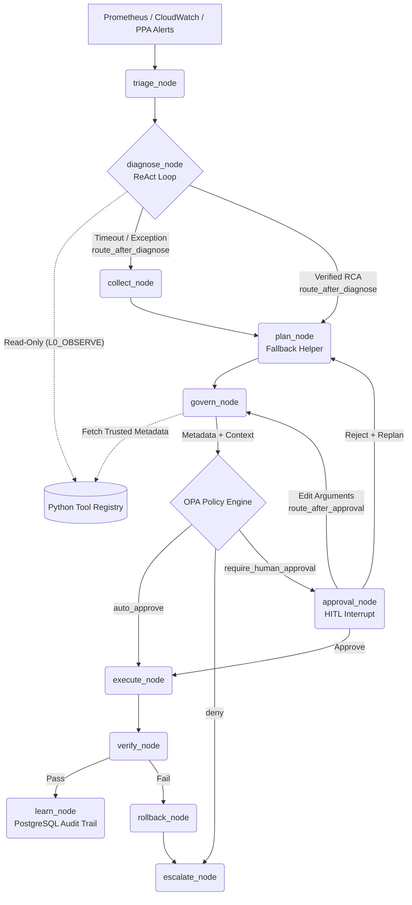

# NEXUS: Autonomous Cross-Provider Self-Healing Architecture

* **Author:** Principal Distributed Systems & AI Agent Architect
* **Status:** Approved for Implementation
* **Date:** 2026-11-13

---

## Overview

NEXUS is an autonomous incident mitigation and self-healing system operating across multi-cloud and cloud-native infrastructure (AWS, Kubernetes, Databases, Message Queues, and Observability stacks). This document specifies the architectural evolution of NEXUS from a static, rule-based pipeline into an autonomous, hypothesis-driven agent workflow. It implements a Zero-Trust governance boundary, structured evidence validation, and deterministic fallbacks to ensure safe execution.

The architecture centers on four core tenets:
1. **Hypothesis-Driven Diagnostic Agent**: An iterative ReAct investigation agent that traverses cross-boundary telemetry using existing in-process Python tool adapters with strict read-only isolation.
2. **Zero-Trust Attribute-Based Governance**: A strict boundary where the LLM only proposes `tool_name` and `parameters`. Open Policy Agent (OPA) evaluates immutable, developer-defined metadata (`blast_radius`, `is_destructive`, `risk_level`) retrieved directly from the Python `ToolRegistry`.
3. **Graceful Degradation via Deterministic Fallbacks**: Existing heuristics (`collect.py`, `default_planner.py`, `action_ladder.py`) are retained as active hot fallbacks. Fallback operations are strictly routed through OPA governance to maintain safety invariants.
4. **Non-Breaking State Evolution**: `IncidentGraphState` is extended with an append-only `messages` trace and structured agentic outputs, preserving compatibility with the Finite State Machine (FSM), NATS JetStream, audit trails, and status APIs.

---

## The Problem

The existing NEXUS remediation pipeline exhibits structural limitations during complex cross-provider outages:
1. **Static Failure Classification**: Alerts are categorized into rigid `IncidentType` enums, limiting the system's ability to address compounded or novel multi-service cascades.
2. **Fixed Snapshot Telemetry**: Diagnostic nodes pull static metrics regardless of incident context, consuming API quota while missing signals across dependent services.
3. **Rigid Remediation Ladders**: Remediation paths are hardcoded by action name in `default_planner.py` and `action_ladder.py`, preventing dynamic multi-step interventions.
4. **LLM Authorization Vulnerabilities**: Implementations that allow models to declare their own risk levels or produce ungrounded diagnostic claims create critical operational hazards.

---

## Goals

- **Provider-Agnostic Symptom Ingestion**: Trigger on generic `AnomalySignal` payloads delivered via NATS JetStream without requiring pre-assigned failure type enums.
- **Direct Python Tool Adapter Binding**: Expose existing AWS and Kubernetes adapters (`src/nexus/tools/`) to the LLM via `tool.as_langchain_tool()`, utilizing existing in-process infrastructure.
- **Strict Read/Write Tool Isolation**: Diagnostic nodes may bind and execute only read-only tools (`risk_level == ToolRiskLevel.L0_OBSERVE`). State-mutating tools are restricted to execution nodes post-governance.
- **Zero-Trust OPA Governance**: Enforce that OPA policy evaluation uses trusted metadata from `ToolRegistry`, treating LLM outputs purely as unverified intent.
- **Graceful Degradation**: Retain existing collectors and planners as active fallback handlers triggered upon LLM timeout or validation failure, maintaining identical safety and governance constraints.
- **Backwards-Compatible State Extension**: Subclass `IncidentGraphState` using LangGraph reducers while preserving FSM and audit bindings.
- **Enhanced HITL Workflow**: Leverage LangGraph `interrupt()` in `approval.py`, enriching Slack notifications with agent causal reasoning and proposed actions, and routing edits back through OPA.

---

## Non-Goals

- **Running External MCP Sidecars**: Deploying external Model Context Protocol daemon processes or SSE proxies is out of scope.
- **Autonomous Stateful Data Deletion**: Deleting persistent datastores (RDS instances, DynamoDB tables, S3 buckets, PVCs) is strictly prohibited by policy.
- **Autonomous IAM Mutations**: Creating or modifying IAM policies, credentials, or role bindings is blocked unconditionally.
- **Replacing Existing FSM Infrastructure**: The core finite state machine, NATS event bus, and PostgreSQL audit trail remain intact.

---

## Critical User Journeys (CUJs)

### CUJ 1: Cross-Provider Anomaly Self-Healing (EKS to AWS DynamoDB)
- **Given**: `checkout-service` runs on EKS with an associated AWS DynamoDB orders table in `production`.
- **When**: A traffic spike saturates DynamoDB Write Capacity Units (WCU), producing write throttles and an HTTP 500 spike in EKS pods.
- **Then**:
  1. NATS JetStream ingests `AnomalySignal` and routes to `triage_node`.
  2. `diagnose_node` iteratively queries pod logs, identifies DynamoDB client exceptions, queries CloudWatch metrics for the table, captures baseline WCU (50), and synthesizes an RCA hypothesis (`confidence = 0.94`).
  3. `plan_node` proposes updating table WCU from 50 to 250 with a rollback step to restore WCU to 50.
  4. `govern_node` queries `ToolRegistry` for `aws_dynamodb_update_table` metadata and evaluates OPA policy.
  5. Because the operation has `blast_radius = "service_wide"` in `environment = "production"`, OPA mandates human approval.
  6. `approval_node` alerts on-call via Slack with Block Kit card and calls `interrupt()`.
  7. On-call approves via Slack; `resume_incident_execution` resumes graph to execute the update, verify error rate drop, and persist outcome to the audit log.

### CUJ 2: Graceful Degradation on LLM Timeout
- **Given**: A node memory leak causes pod evictions in a staging cluster.
- **When**: The diagnostic agent encounters an external LLM API timeout (>60s).
- **Then**:
  1. The exception is caught by the LangGraph error handler in `diagnose_node`, setting `state["fallback_active"] = True`.
  2. The graph routes to `collect_node` via `route_after_diagnose` to capture standard platform telemetry.
  3. Execution advances to `plan_node`, which bypasses the LLM due to the fallback flag and invokes the deterministic helper `build_k8s_default_steps()` from `default_planner.py`.
  4. **Crucially**, the deterministic plan is routed to `govern_node` and evaluated by OPA.
  5. OPA approves the safe fallback action, and the incident is remediated.

### CUJ 3: Zero-Trust Governance Hard Deny on Destructive Action
- **Given**: A corrupted disk causes volume mount failures on an RDS instance.
- **When**: An LLM planner attempts to resolve the failure by proposing `aws_rds_delete_db_instance`.
- **Then**:
  1. `govern_node` intercepts the requested tool name and resolves its metadata in `ToolRegistry`.
  2. `ToolRegistry` reports `is_destructive = True` and `domain = "rds"`.
  3. OPA evaluates the hard deny rule against the trusted registry metadata.
  4. OPA emits `decision = "deny"`. Execution halts immediately without prompting human approval, routing to `escalate_node`.

---

## Technical Plan (Architecture)

### Target Scope (File Manifest)

| File Path | Action | Description |
| :--- | :--- | :--- |
| `src/nexus/tools/base.py` | `[Modify]` | Add `blast_radius`, `is_destructive`, `allows_unbacked_rollback`, and `.as_langchain_tool()` wrapper |
| `src/nexus/tools/registry.py` | `[Modify]` | Add `.get_diagnostic_tools()` and `.get_remediation_tools()` category filters |
| `src/nexus/tools/aws/schemas.py` | `[Modify]` | Add Pydantic schemas for `DynamoDBUpdateTableInput`, `RDSDeleteInstanceInput`, and `DynamoDBDescribeTableInput` |
| `src/nexus/tools/aws/mutate_tools.py` | `[Modify]` | Implement `DynamoDBUpdateTableTool` and `RDSDeleteInstanceTool` with strict safety metadata |
| `src/nexus/tools/aws/observe_tools.py` | `[Modify]` | Implement `DynamoDBDescribeTableTool` with `ToolRiskLevel.L0_OBSERVE` |
| `src/nexus/graph/state.py` | `[Modify]` | Extend `IncidentGraphState` with `messages: Annotated[list[Any], add_messages]` and `fallback_active: bool` |
| `src/nexus/bus/events/event.py` | `[Modify]` | Add `AnomalySignal` payload Pydantic model for generic symptom ingestion |
| `src/nexus/graph/workflow_events.py` | `[Modify]` | Map incoming NATS JetStream `AnomalySignal` to graph initialization payload |
| `src/nexus/graph/routes.py` | `[Modify]` | Implement `route_after_diagnose` (plan vs collect) and update `route_after_approval` (handle edit -> govern) |
| `src/nexus/graph/builder.py` | `[Modify]` | Update StateGraph topology: `triage -> diagnose`, conditional fallback to `collect`, and approval edit loop |
| `src/nexus/graph/nodes/triage.py` | `[Modify]` | Ingest generic `AnomalySignal` fields into `IncidentGraphState` |
| `src/nexus/graph/nodes/diagnose.py` | `[Modify]` | Implement ReAct diagnostic loop binding `L0_OBSERVE` tools with 60s timeout and log truncation |
| `src/nexus/graph/nodes/plan.py` | `[Modify]` | Generate structured `RemediationPlan`; fallback to `default_planner` helpers on error/flag |
| `src/nexus/governance/policy_engine.py` | `[Modify]` | Refactor `PolicyEngine.evaluate()` for unified batch evaluation against `/v1/data/nexus/governance` |
| `deploy/opa/nexus_policies.rego` | `[Modify]` | Codify zero-trust Rego rules: hard denies for destructive actions, mandatory approval for unbacked mutations |
| `src/nexus/graph/nodes/govern.py` | `[Modify]` | Implement short-lived PostgreSQL advisory locking (`zlib.crc32`) and batch OPA metadata enrichment |
| `src/nexus/graph/nodes/approval.py` | `[Modify]` | Wrap Slack HITL workflow around LangGraph `interrupt()`, extracting operator action decisions |
| `src/nexus/integration/slack_templates.py` | `[Modify]` | Render rich Block Kit approval cards displaying agent RCA rationale, proposed steps, and action buttons |
| `src/nexus/graph/nodes/execute.py` | `[Modify]` | Re-acquire advisory lock and execute approved plan steps sequentially via `ToolRegistry.execute_tool()` |
| `src/nexus/graph/nodes/verify.py` | `[Modify]` | Evaluate post-execution metric thresholds via type-safe `VerificationCondition` (no `eval()`) |
| `src/nexus/graph/nodes/learn.py` | `[Modify]` | Persist post-incident resolution outcome and causal trajectory directly into PostgreSQL audit trail |

---

### Architectural Flowchart



---

### Data Contracts & State Integration

The `IncidentGraphState` is extended using LangGraph reducers to safely append ReAct turns while retaining existing FSM compatibility.

```python
from typing import Any, Literal, Optional, Annotated
from pydantic import BaseModel, Field
from langgraph.graph.message import add_messages
from typing_extensions import TypedDict

class AnomalySignal(BaseModel):
    """Provider-agnostic symptom trigger."""
    signal_id: str
    source: Literal["prometheus", "cloudwatch", "otel", "ppa_forecaster"]
    provider: Literal["aws", "kubernetes", "hybrid"]
    environment: Literal["dev", "staging", "production", "production_tier_0"]
    target_service: str
    target_resource_id: str
    symptom_summary: str
    raw_metrics_or_alert: dict[str, Any]
    timestamp: str

class VerificationCondition(BaseModel):
    """Structured, safe verification contract (no Python eval)."""
    metric_name: str
    operator: Literal["<", "<=", ">", ">=", "=="]
    threshold: float
    window_seconds: int = 60

class PlannedToolStep(BaseModel):
    """Generated remediation step referencing tools from ToolRegistry."""
    step_index: int = 0
    tool_name: str = Field(..., alias="action_tool", description="Registered NexusTool name")
    parameters: dict[str, Any] = Field(default_factory=dict, alias="action_args")
    rationale: str = Field(default="", description="Operator-facing rationale")
    # Inverse rollback execution
    rollback_tool: Optional[str] = None
    rollback_parameters: Optional[dict[str, Any]] = Field(default=None, alias="rollback_args")
    # Post-execution verification probe
    verification_tool: str
    verification_parameters: dict[str, Any] = Field(default_factory=dict, alias="verification_args")
    verification_condition: VerificationCondition

class IncidentGraphState(TypedDict):
    # Existing core fields preserved for FSM and observability
    incident_id: str
    target: Any
    platform: str
    fsm_state: str
    telemetry: dict[str, Any]
    diagnosis: dict[str, Any]
    execution_records: list[dict[str, Any]]
    audit_log: list[dict[str, Any]]
    retry_count: int
    max_retries: int
    
    # Autonomous agent extensions
    messages: Annotated[list[Any], add_messages]  # Scratchpad for ReAct turns
    anomaly_signal: dict[str, Any]
    agentic_rca: Optional[dict[str, Any]]
    plan: Optional[dict[str, Any]]
    governance: Optional[dict[str, Any]]
    human_feedback: Optional[str]
    fallback_active: bool
```

---

### Concurrency and Zero-Trust Governance

1. **Immutable Tool Metadata**: `NexusTool` base classes in `src/nexus/tools/base.py` define `ToolRiskLevel`, `blast_radius: str`, `is_destructive: bool`, and `allows_unbacked_rollback: bool`. The LLM cannot output or modify these values.
2. **PostgreSQL Advisory Locking**: To prevent race conditions where concurrent events bypass active cooldowns, `govern_node` acquires a short-lived PostgreSQL advisory lock keyed by `zlib.crc32(target_service.encode())` to atomically evaluate cooldown and set an execution reservation, releasing the lock before entering `approval_node`. `execute_node` re-acquires the lock during mutation and releases it post-`verify_node`, preventing pool exhaustion across human interrupts.
3. **OPA Evaluation Payload**: The payload delivered to `/v1/data/nexus/governance` aggregates the immutable tool metadata. Tools labeled `allows_unbacked_rollback = True` (e.g., safe restarts) will not trigger hard-denies if a rollback step is omitted.

```json
{
  "input": {
    "action": {
      "tool_name": "aws_dynamodb_update_table",
      "parameters": {"table_name": "orders", "write_capacity_units": 250},
      "is_destructive": false,
      "blast_radius": "service_wide",
      "allows_unbacked_rollback": false
    },
    "context": {
      "environment": "production",
      "target_service": "checkout-service",
      "cooldown_active": false,
      "circuit_breaker_open": false,
      "operator_confirmed": false
    }
  }
}
```

---

## Alternatives Considered

1. **In-Process Python Tool Adapters vs. External MCP Daemon Sidecars**
   - *Considered*: Deploying external Model Context Protocol (MCP) servers (e.g., `awslabs/mcp`) running alongside NEXUS via JSON-RPC.
   - *Rejected*: Introduces process supervisors, sidecar OOM risks, and socket connection failures during active incidents. Wrapping existing audited Python adapters via LangChain `@tool` provides discovery without operational bloat.
2. **Hypothesis-Driven ReAct Loop vs. Static DAGs**
   - *Considered*: Building static Directed Acyclic Graphs (DAGs) for every known failure path.
   - *Rejected*: Fails to scale across unbounded cross-service interactions. ReAct allows dynamic pivoting based on observed telemetry.
3. **Decoupled OPA Engine vs. Python-Native Policy**
   - *Considered*: Implementing policies directly in Python or using Pydantic validators.
   - *Rejected*: Violates separation of concerns. Security and SRE teams require a centralized, auditable policy language (Rego) separate from application logic.

---

## Risks & Mitigations

| Risk | Mitigation |
| :--- | :--- |
| **Indirect Prompt Injection via Logs** | A compromised pod could emit malicious log statements to hijack the LLM. *Mitigation*: Diagnostic tools apply strict truncation (max 100 lines/4KB) and logs are executed strictly in a `ToolRiskLevel.L0_OBSERVE` context where no state mutations can occur. |
| **Concurrency & Race Conditions** | Overlapping alerts for the same service bypassing cooldown periods. *Mitigation*: PostgreSQL advisory locks keyed by target service restrict evaluation and execution to one concurrent process per resource. |
| **LLM Context Exhaustion / API Quota** | Runaway diagnostic loops exhaust tokens or external API limits. *Mitigation*: Enforced turn limit (`max_iterations = 8`). Surpassing limits falls back to deterministic capture and planning. |
| **Destructive Governance Bypass** | Malicious or hallucinated tool proposals evading rules. *Mitigation*: Zero-trust architecture. OPA evaluates metadata retrieved securely from `ToolRegistry`, completely isolating LLM outputs from the decision logic. |

---

## Non-Functional Requirements

- **Performance & Latency Budgets**:
  - The ReAct diagnostic loop is constrained to a hard 60-second overall timeout.
  - Individual tool invocations are capped at 5 seconds.
  - Fallback initiation latency upon LLM timeout/error must be < 500 milliseconds.
- **Security & Privacy**:
  - Verification operations must use the structured `VerificationCondition` model. Python `eval()` or string execution is strictly prohibited.
- **Resilience**:
  - Deterministic fallbacks must be evaluated by OPA identically to LLM-generated plans.
- **Auditability**:
  - Every tool invocation (diagnostic and mutating) and LLM timeout must be logged to the PostgreSQL audit trail, ensuring historical incident replays are functionally complete.

---

## Detailed Implementation Plan

### Phase 1: Tool Registry & Metadata Hardening (`src/nexus/tools/`)

1. **Extend `NexusTool` Base Class** (`src/nexus/tools/base.py`):
   - Add immutable fields: `blast_radius: str = "service"`, `is_destructive: bool = False`, and `allows_unbacked_rollback: bool = False`.
   - Implement `.as_langchain_tool()` method wrapping `execute()` using `langchain_core.tools.StructuredTool.from_function()`.
2. **Implement DynamoDB & RDS Tool Schemas** (`src/nexus/tools/aws/schemas.py`):
   - Define `DynamoDBUpdateTableInput`: `table_name: str`, `billing_mode: Optional[str]`, `read_capacity_units: Optional[int]`, `write_capacity_units: Optional[int]`, `region: str = "us-east-1"`.
   - Define `DynamoDBDescribeTableInput`: `table_name: str`, `region: str = "us-east-1"`.
   - Define `RDSDeleteInstanceInput`: `db_instance_identifier: str`, `skip_final_snapshot: bool = False`, `region: str = "us-east-1"`.
3. **Implement AWS Tools & Registry Exposure** (`src/nexus/tools/aws/mutate_tools.py`, `observe_tools.py`):
   - `DynamoDBUpdateTableTool` in `mutate_tools.py`: `risk_level = ToolRiskLevel.L2_MUTATE_APPROVAL`, `blast_radius = "service_wide"`, `is_destructive = False`, `allows_unbacked_rollback = False`. Implement inverse action in `.get_rollback_action()`.
   - `RDSDeleteInstanceTool` in `mutate_tools.py`: `risk_level = ToolRiskLevel.L3_DESTRUCTIVE`, `blast_radius = "database"`, `is_destructive = True`, `allows_unbacked_rollback = False`.
   - `DynamoDBDescribeTableTool` in `observe_tools.py`: `risk_level = ToolRiskLevel.L0_OBSERVE`, `blast_radius = "none"`, `is_destructive = False`.
4. **Registry Filter Methods** (`src/nexus/tools/registry.py`):
   - Implement `ToolRegistry.get_diagnostic_tools()` returning only tools where `risk_level == ToolRiskLevel.L0_OBSERVE`.
   - Implement `ToolRegistry.get_remediation_tools()` returning mutating tools (`L1_SAFE`, `L2_MUTATE_APPROVAL`, `L3_DESTRUCTIVE`).
- **Exit Criteria**:
  - `pytest tests/unit/nexus/tools/test_tool_registry_metadata.py tests/unit/nexus/tools/test_aws_dynamodb_tools.py` passes with 100% assertions satisfied.

---

### Phase 2: State Extension & Ingestion Boundary (`src/nexus/graph/` & `bus/`)

1. **Extend LangGraph State** (`src/nexus/graph/state.py`):
   - Update `IncidentGraphState` TypedDict to include `messages: Annotated[list[Any], add_messages]`, `anomaly_signal: dict[str, Any]`, `agentic_rca: Optional[dict[str, Any]]`, and `fallback_active: bool`.
   - Clean up deprecated comment `# 1. Deterministic Telemetry (NO ReAct loop!)`.
2. **Define Generic `AnomalySignal` Event Model** (`src/nexus/bus/events/event.py`):
   - Implement `AnomalySignal` Pydantic model with fields: `signal_id`, `source`, `provider`, `environment`, `target_service`, `target_resource_id`, `symptom_summary`, `raw_metrics_or_alert`, and `timestamp`.
3. **Update Triage & Ingestion Boundary** (`src/nexus/graph/nodes/triage.py`, `src/nexus/graph/workflow_events.py`):
   - In `triage_node`, parse `AnomalySignal` into `target`, `platform`, `environment`, and initial diagnostic messages.
   - Update `workflow_events.py` to route NATS `nexus.anomaly.*` messages directly to graph execution.
- **Exit Criteria**:
  - `pytest tests/unit/nexus/graph/test_state_compatibility.py` passes, verifying backwards compatibility of state transitions.

---

### Phase 3: ReAct Diagnostics, Topology & Fallback (`src/nexus/graph/`)

1. **Implement ReAct Investigation Agent** (`src/nexus/graph/nodes/diagnose.py`):
   - Instantiate LangChain agent binding only `ToolRegistry.get_diagnostic_tools()`.
   - Enforce `max_iterations = 8` and hard overall timeout of 60 seconds (`asyncio.wait_for`).
   - Enforce truncation on tool observations: maximum 100 lines or 4KB text.
   - On completion, map agent findings to `DiagnosisResult` schema (`root_cause`, `failure_class`, `confidence`, `suggested_action`) and update `state["diagnosis"]`.
2. **Implement Fallback Exception Handling** (`src/nexus/graph/nodes/diagnose.py`):
   - On `asyncio.TimeoutError` or LLM API exception, log warning, set `state["fallback_active"] = True`, and terminate ReAct turn cleanly.
3. **Update Graph Routing & Topology** (`src/nexus/graph/routes.py`, `src/nexus/graph/builder.py`):
   - In `routes.py`, define `route_after_diagnose(state: IncidentGraphState) -> Literal["plan", "collect"]`:
     - If `state.get("fallback_active")` is True: return `"collect"`.
     - Else: return `"plan"`.
   - In `builder.py`, modify entry topology:
     - Connect `workflow.add_edge("triage", "diagnose")`.
     - Add conditional edge: `workflow.add_conditional_edges("diagnose", route_after_diagnose, {"plan": "plan", "collect": "collect"})`.
     - Connect `workflow.add_edge("collect", "plan")`.
- **Exit Criteria**:
  - `pytest tests/unit/nexus/graph/test_agent_fallback.py` passes, verifying that LLM timeout smoothly activates `collect_node` and transitions to `plan_node`.

---

### Phase 4: Planning & Verification Contracts (`src/nexus/graph/nodes/`)

1. **Remediation Planner Node** (`src/nexus/graph/nodes/plan.py`):
   - If `state.get("fallback_active") == True` or LLM planning fails:
     - Invoke `build_k8s_default_steps` or `build_aws_default_steps` from `src/nexus/graph/nodes/default_planner.py`.
     - Wrap returned steps into `RemediationPlan` model.
   - Otherwise, prompt LLM to generate structured `RemediationPlan` adhering strictly to `PlannedToolStep` and `VerificationCondition`.
2. **Safe Verification Node** (`src/nexus/graph/nodes/verify.py`):
   - Parse `step.verification_condition` (`metric_name`, `operator`, `threshold`, `window_seconds`).
   - Query metric via registered observe tool (e.g., CloudWatch or Prometheus).
   - Evaluate threshold condition using operator mapping dictionary (`operator.lt`, `operator.le`, `operator.gt`, `operator.ge`, `operator.eq`) without Python `eval()`.
- **Exit Criteria**:
  - `pytest tests/unit/nexus/graph/test_plan_and_verify.py` passes, verifying safe condition evaluation and deterministic fallback activation.

---

### Phase 5: Zero-Trust Governance & Locking (`src/nexus/governance/` & `deploy/opa/`)

1. **PostgreSQL Advisory Locking in Governance** (`src/nexus/graph/nodes/govern.py`):
   - Acquire short-lived PostgreSQL advisory lock via `get_database_client()`:
     `SELECT pg_try_advisory_lock(zlib.crc32(service.encode()))`.
   - Atomically check cooldown in `cooldown_store.py` and circuit breaker in `circuit_breaker.py`.
   - If locked or in cooldown, set `governance.allowed = False` and route to escalate.
   - Release advisory lock immediately before transitioning to `approval_node`.
2. **Batch OPA Metadata Enrichment** (`src/nexus/graph/nodes/govern.py`):
   - Intercept each proposed `tool_name` from `state["plan"]`.
   - Query `ToolRegistry.get_tool(step.tool_name)` for developer-audited metadata: `is_destructive`, `blast_radius`, `allows_unbacked_rollback`.
   - Construct enriched OPA input payload.
3. **Refactor PolicyEngine & Rego Policies** (`src/nexus/governance/policy_engine.py`, `deploy/opa/nexus_policies.rego`):
   - Update `PolicyEngine.evaluate()` to query `/v1/data/nexus/governance` evaluating `allow`, `require_human_approval`, and `deny_reasons`.
   - In `nexus_policies.rego`, add rules:
     - Hard deny if `input.action.is_destructive == true`.
     - Hard deny if `input.action.blast_radius == "account_wide"`.
     - Require approval if `input.context.environment == "production"` and `input.action.blast_radius == "service_wide"`.
     - Require approval if missing rollback step and `input.action.allows_unbacked_rollback == false`.
- **Exit Criteria**:
  - `pytest tests/unit/nexus/governance/test_zero_trust_opa.py` passes, proving hard denies on destructive tools and auto-approvals for safe rollbacks.

---

### Phase 6: HITL Interrupt, Execution & Audit (`src/nexus/`)

1. **Slack Block Kit Enrichment** (`src/nexus/integration/slack_templates.py`):
   - Format approval cards rendering: incident ID, service, LLM causal reasoning hypothesis, proposed tool steps with blast radiuses, rollback plan, and buttons: `Approve`, `Edit Arguments`, `Reject`.
2. **Approval Node with LangGraph Interrupt** (`src/nexus/graph/nodes/approval.py`):
   - Call `interrupt({"incident_id": incident_id, "plan": plan, "prompt": "Operator action required"})`.
   - Upon resume via `Command(resume=...)`, parse operator response: `action` (`"approved"`, `"edit"`, `"rejected"`), optional edited parameters.
   - Update `state["approval_decision"] = action`. If edited, update `state["plan"]` with operator arguments.
3. **Approval Route Update** (`src/nexus/graph/routes.py`, `src/nexus/graph/builder.py`):
   - In `routes.py`, update `route_after_approval(state: IncidentGraphState) -> Literal["execute", "govern", "escalate"]`:
     - If decision == `"approved"`: return `"execute"`.
     - If decision == `"edit"`: return `"govern"`.
     - Else: return `"escalate"`.
   - In `builder.py`, register conditional edge target `"govern": "govern"` from `approval_node`.
4. **Execution & Re-Locking** (`src/nexus/graph/nodes/execute.py`):
   - Re-acquire PostgreSQL advisory lock for the target service.
   - Execute approved steps sequentially via `ToolRegistry.execute_tool()`.
   - Capture `ExecutionRecord` with pre-mutation snapshot and execution duration.
5. **PostgreSQL Audit Trail Recording** (`src/nexus/graph/nodes/learn.py`):
   - Record comprehensive post-incident record into PostgreSQL audit table (causal chain, executed tools, operator decision, verification result).
   - Release advisory lock if held.
- **Exit Criteria**:
  - `pytest tests/unit/nexus/graph/test_approval_interrupt.py tests/integration/test_nexus_cross_provider_pipeline.py` passes end-to-end.

---

## Verification Plan

### Automated Tests

1. **Unit Tests**:
   - `tests/unit/nexus/tools/test_tool_registry_metadata.py`: Verify immutable metadata lookup and `.as_langchain_tool()` conversion.
   - `tests/unit/nexus/tools/test_aws_dynamodb_tools.py`: Test `aws_dynamodb_update_table` and `aws_dynamodb_describe_table`.
   - `tests/unit/nexus/governance/test_zero_trust_opa.py`: Test OPA Rego rules:
     - Destructive action on stateful service -> `deny`.
     - IAM mutation -> `deny`.
     - Pod restart without rollback tool (`allows_unbacked_rollback == True`) -> `auto_approve` in staging.
     - Service-wide blast radius in production -> `require_human_approval`.
     - Target service in active cooldown (within 300s window) -> `require_human_approval`.
   - `tests/unit/nexus/graph/test_agent_fallback.py`: Simulate LLM timeout in `diagnose_node` and verify fallback transition to `collect.py`, `default_planner.py`, and `govern_node`.
   - `tests/unit/nexus/graph/test_state_compatibility.py`: Ensure extended `IncidentGraphState` satisfies existing FSM and audit trail requirements.
   - `tests/unit/nexus/graph/test_approval_interrupt.py`: Test LangGraph `interrupt()` pause, resume, and edit routing back to `govern_node`.

2. **Integration Tests**:
   - `tests/integration/test_nexus_cross_provider_pipeline.py`: Run end-to-end simulated incident (DynamoDB throttling affecting EKS pods) verifying:
     - Ingestion of `AnomalySignal`.
     - ReAct investigation across K8s logs and CloudWatch metrics.
     - Zero-trust governance evaluation.
     - LangGraph `interrupt()` pause and resume.
     - Execution, verification, and audit trail generation.

3. **Regression Tests**:
   - `pytest tests/unit/nexus/`

---

*Drafted with EGM*
