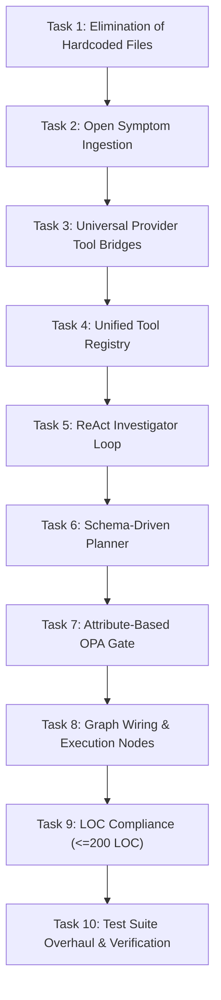

# NEXUS Autonomous SRE Refactoring Implementation Plan

> **For agentic workers:** REQUIRED SUB-SKILL: Use superpowers:subagent-driven-development (recommended) or superpowers:executing-plans to implement this plan task-by-task. Steps use checkbox (`- [ ]`) syntax for tracking.

**Goal:** Eliminate all hardcoded failure enums, static telemetry snapshots, rigid platform target parsers, heuristic RCA rules, template planners, and tool-name-locked OPA policies in NEXUS, replacing them with a provider-agnostic, tool-calling Agentic Workflow in LangGraph supporting any AWS service and any Kubernetes resource/CRD dynamically.

**Architecture:** An iterative, multi-turn LangGraph system with 5 core stages:
1. Universal Symptom Ingestion emitting typed `SymptomSignal` envelopes (`SignalSource`, `SignalKind`, `Severity`).
2. Multi-turn ReAct Investigator Agent (`rca_reasoner` ↔ `rca_tool_executor`) looping over read-only AWS Boto3 and Kubernetes `DynamicClient` tools to prove root cause and emit a structured `RCAReport`.
3. Schema-Driven Remediation Planner (`plan_node`) generating an atomic `RemediationPlan` with inverse rollback calls and read-only verification checks.
4. Attribute-Based Zero-Trust OPA Governance Gate (`govern_node` + `policy_engine.py` + `deploy/opa/nexus_policies.rego`) combining deterministic Python risk overrides with Rego ABAC evaluation (`ALLOW_AUTO`, `REQUIRE_APPROVAL`, `DENY`).
5. Governed Execution, Human-in-the-Loop Interrupt (`approval_node`), and Closed-Loop Verification (`verify_node` / `rollback_node`).

**Tech Stack:** Python 3.13, LangGraph 1.2+, LangChain Core 1.8+, Kubernetes Python Client (`DynamicClient`, `CoreV1Api`), Boto3/Botocore, Open Policy Agent (Rego), Pydantic v2, Pytest 9.2+.

**Spec:** [docs/designs/nexus_agentic_refactoring_prompt_hardcoding_audit.md](file:///run/media/vatsal/DATA/Projects/predictive_pod_autoscaler/docs/designs/nexus_agentic_refactoring_prompt_hardcoding_audit.md)

---

## Global Constraints

- **Strict Line Count:** Every Python file in `src/nexus/` must strictly adhere to `<= 200` LOC as enforced by `scripts/check_loc.py`.
- **Zero Hardcoded Enums:** No closed failure root-cause enum sets or fixed incident-to-action dispatch maps.
- **Provider Agnostic:** Inspection, diagnosis, remediation, and verification must support arbitrary AWS services (Lambda, RDS, ECS, SQS, DynamoDB, ALB, S3, ElastiCache, etc.) and arbitrary Kubernetes kinds (`Pod`, `Deployment`, `StatefulSet`, `DaemonSet`, `Job`, `PersistentVolumeClaim`, `Ingress`, CRDs).
- **Strict Read/Write Tool Separation:** The Investigator Agent only receives read-only observation tools; mutating tools are schema-only for the Planner and executed exclusively by `execute_node` after OPA and human approval gates.
- **Deterministic Rollback Guarantee:** Every mutating action must carry an explicit inverse rollback tool call capturing pre-incident state.
- **Test Integrity:** 100% of unit and integration tests must pass under `.venv/bin/pytest`.

---

## Review Focus

1. **Boto3 Parameter Validation Failure:** Investigator LLM emits invalid kwargs for a Boto3 client method → `execute_aws_inspect` must catch `ParamValidationError` and return structured self-correction hints rather than crashing the loop.
2. **LLM Under-Reporting Risk:** Planner LLM labels a destructive operation (e.g. `delete_db_instance`) as low risk / reversible → Python deterministic classifier must override `action_category` to `"destructive"`, `reversible` to `False`, and `blast_radius` to `"stateful_data"`, causing OPA to reject or require approval.
3. **Stateful Data Mutation Protection:** A remediation plan attempts a destructive action on a stateful resource (`RDS`, `DynamoDB`, `StatefulSet`, `PVC`) → OPA policy must hard `DENY` with an explicit deny reason.
4. **Missing Rollback Plan:** A mutating tool action lacks `rollback_tool_name` or `rollback_arguments` → OPA policy must deny execution (`has_rollback_plan == false`).
5. **Closed-Loop Verification Failure & Rollback Trigger:** A post-remediation check fails after `stabilization_wait_seconds` → Graph must cleanly route to `rollback_node` to execute inverse actions in reverse order before escalating to human operators.

---

## Task Decomposition



---

### Task 1: Elimination of Legacy Hardcoded Files & Reference Cleanup

**Files:**
- Delete:
  - `src/nexus/graph/nodes/collect.py`
  - `src/nexus/graph/platform/aws_snapshot.py`
  - `src/nexus/graph/platform/aws_target.py`
  - `src/nexus/graph/platform/aws_telemetry.py`
  - `src/nexus/graph/platform/k8s_snapshot.py`
  - `src/nexus/graph/platform/k8s_target.py`
  - `src/nexus/graph/platform/k8s_telemetry.py`
  - `src/nexus/graph/rca/synthesis_rules.py`
  - `src/nexus/graph/rca/multi_agent_rca.py`
  - `src/nexus/graph/rca/log_analyst.py`
  - `src/nexus/graph/rca/metrics_analyst.py`
  - `src/nexus/graph/rca/topology_analyst.py`
  - `src/nexus/graph/rca/baseline.py`
  - `src/nexus/graph/rca/synthesizer.py`
  - `src/nexus/graph/nodes/default_planner.py`
  - `src/nexus/graph/nodes/k8s_plan_helpers.py`
  - `src/nexus/graph/nodes/pluggable_planner.py`
  - `src/nexus/graph/nodes/adaptive_recovery.py`
  - `src/nexus/governance/action_ladder.py`
  - `src/nexus/reasoning/correlator_rules.py`
  - `src/nexus/reasoning/confidence_constants.py`
  - `src/nexus/reasoning/validator/consistency.py`
  - `src/nexus/reasoning/validator/downgrade.py`
  - `src/nexus/governance/live_state/pod_checker.py`
  - `src/nexus/governance/live_state/deployment_checker.py`
  - `src/nexus/learning/kb_patterns.py`
  - `src/nexus/agents/k8s_tools/` (all files: `client.py`, `metrics.py`, `read_tools.py`, `rollback.py`, `write_tools.py`, `__init__.py`) and `src/nexus/agents/k8s_tools.py`
- Modify:
  - `src/nexus/graph/nodes/__init__.py`
  - `src/nexus/graph/platform/__init__.py`
  - `src/nexus/graph/platform/aws.py`
  - `src/nexus/graph/platform/k8s.py`
  - `src/nexus/graph/rca/__init__.py`
  - `src/nexus/governance/__init__.py`
  - `src/nexus/governance/live_state/__init__.py`
  - `src/nexus/governance/live_state/validator.py`
  - `src/nexus/reasoning/__init__.py`
  - `src/nexus/reasoning/event_correlator.py`
  - `src/nexus/reasoning/confidence_scorer.py`
  - `src/nexus/reasoning/validator/__init__.py`
  - `src/nexus/reasoning/validator/validator.py`
  - `src/nexus/learning/__init__.py`
  - `src/nexus/learning/knowledge_base.py`
  - `src/nexus/predictive/executors.py`
  - `src/nexus/predictive/prescaler.py`
  - `src/nexus/server.py`
  - `src/nexus/server_bootstrap.py`
  - `src/nexus/observability/status_context.py`

**Interfaces:**
- Consumes: Clean repo state.
- Produces: Removed legacy modules, cleaned package `__init__.py` exports, and decoupled imports without broken symbol references.

- [ ] **Step 1: Write a verification script / test to confirm deletion list**
- [ ] **Step 2: Delete the 27 legacy files and legacy directory `src/nexus/agents/k8s_tools`**
- [ ] **Step 3: Update all imports across `src/nexus/` to remove references to deleted modules**
- [ ] **Step 4: Verify Python syntax and import resolution with `.venv/bin/python -m compileall src/nexus`**
- [ ] **Step 5: Commit cleanup changes**

---

### Task 2: Open Symptom Ingestion Layer

**Files:**
- Modify: `src/nexus/bus/events/enums.py`
- Modify: `src/nexus/bus/events/event.py`
- Modify: `src/nexus/telemetry/log_parser.py`
- Modify: `src/nexus/agents/k8s/agent.py`
- Test: `tests/unit/nexus/test_open_symptom_ingest.py`

**Interfaces:**
- Consumes: Raw telemetry, log lines, Kubernetes `v1.Event`s.
- Produces: `SignalSource`, `SignalKind`, `Severity`, `SymptomSignal`.

- [ ] **Step 1: Write tests for `SymptomSignal`, open log parser, and generic K8s event watcher in `tests/unit/nexus/test_open_symptom_ingest.py`**
- [ ] **Step 2: Implement `SignalSource`, `SignalKind`, and `Severity` enums in `src/nexus/bus/events/enums.py`**
- [ ] **Step 3: Implement `SymptomSignal` Pydantic model in `src/nexus/bus/events/event.py`**
- [ ] **Step 4: Refactor `src/nexus/telemetry/log_parser.py` to group error/fatal/5xx logs into `SymptomSignal(kind=SignalKind.ERROR_LOG_BURST)` (<= 200 LOC)**
- [ ] **Step 5: Refactor `src/nexus/agents/k8s/agent.py` to watch `v1.Event` (type == "Warning") across all `involvedObject.kind`s and emit `SymptomSignal(kind=SignalKind.STATE_TRANSITION)` (<= 200 LOC)**
- [ ] **Step 6: Run tests and verify: `.venv/bin/pytest tests/unit/nexus/test_open_symptom_ingest.py -v`**
- [ ] **Step 7: Commit**

---

### Task 3: Universal Provider Tool Bridges (AWS & Kubernetes)

**Files:**
- Create: `src/nexus/tools/aws/universal.py`
- Create: `src/nexus/tools/k8s/universal.py`
- Test: `tests/unit/nexus/tools/test_universal_aws_tools.py`
- Test: `tests/unit/nexus/tools/test_universal_k8s_tools.py`

**Interfaces:**
- Consumes: Boto3 client, Kubernetes `DynamicClient`, `CoreV1Api`.
- Produces:
  - AWS tools: `execute_aws_inspect`, `execute_aws_query_telemetry`, `execute_aws_mutate`.
  - Kubernetes tools: `execute_k8s_inspect`, `execute_k8s_get_logs`, `execute_k8s_mutate`.

- [ ] **Step 1: Write tests for `universal.py` (AWS & K8s) covering read operations, telemetry queries, mutation restrictions, and error recovery in `tests/unit/nexus/tools/`**
- [ ] **Step 2: Implement `src/nexus/tools/aws/universal.py` with `ALLOWED_READ_PREFIXES`, `DENIED_READ_OPERATIONS`, `DENIED_MUTATE_SERVICES`, and execution functions (<= 200 LOC)**
- [ ] **Step 3: Implement `src/nexus/tools/k8s/universal.py` using `DynamicClient` and `CoreV1Api` for any API version / kind with strategic merge patch, scale, rollout restart, and delete pod (<= 200 LOC)**
- [ ] **Step 4: Run tests: `.venv/bin/pytest tests/unit/nexus/tools/test_universal_aws_tools.py tests/unit/nexus/tools/test_universal_k8s_tools.py -v`**
- [ ] **Step 5: Commit**

---

### Task 4: Unified Tool Registry with Read/Write Separation & MCP Extensibility

**Files:**
- Modify: `src/nexus/tools/registry.py`
- Test: `tests/unit/nexus/tools/test_tool_registry_separation.py`

**Interfaces:**
- Consumes: Universal AWS and K8s tools, MCP server config.
- Produces:
  - `registry.get_read_only_tools_as_langchain() -> list[StructuredTool]`
  - `registry.get_mutating_tool_schemas() -> list[dict]`
  - `registry.get_read_only_tool_schemas() -> list[dict]`
  - `registry.execute_read_only(tool_name, tool_args) -> Any`
  - `registry.execute_mutating(tool_name, tool_args) -> Any`
  - `registry.load_mcp_tools(mcp_servers_config)`

- [ ] **Step 1: Write tests verifying read-only and mutating tool separation, schema extraction, and execution in `tests/unit/nexus/tools/test_tool_registry_separation.py`**
- [ ] **Step 2: Refactor `src/nexus/tools/registry.py` to register universal tools, assign metadata (`is_mutating: bool`, `provider: str`), and provide schema extraction and execution methods (<= 200 LOC)**
- [ ] **Step 3: Add `load_mcp_tools(mcp_servers_config)` to `ToolRegistry`**
- [ ] **Step 4: Run tests: `.venv/bin/pytest tests/unit/nexus/tools/test_tool_registry_separation.py tests/unit/nexus/tools/test_tool_registry_metadata.py -v`**
- [ ] **Step 5: Commit**

---

### Task 5: Hypothesis-Driven ReAct Investigator Loop

**Files:**
- Modify: `src/nexus/graph/rca/result.py`
- Modify: `src/nexus/graph/nodes/diagnose.py`
- Test: `tests/unit/nexus/graph/test_multi_agent_rca.py`

**Interfaces:**
- Consumes: `SymptomSignal`, read-only tools from `ToolRegistry`, Chat LLM.
- Produces: `EvidenceCitation`, `RCAReport`, `rca_reasoner_node`, `rca_tool_executor_node`.

- [ ] **Step 1: Write unit tests for multi-turn `rca_reasoner_node <-> rca_tool_executor_node` loop in `tests/unit/nexus/graph/test_multi_agent_rca.py` (AWS & K8s, hypothesis falsification, self-correction on Boto3 `ParamValidationError`)**
- [ ] **Step 2: Implement `EvidenceCitation` and `RCAReport` models in `src/nexus/graph/rca/result.py` (<= 200 LOC)**
- [ ] **Step 3: Implement `rca_reasoner_node` and `rca_tool_executor_node` in `src/nexus/graph/nodes/diagnose.py` with `RCA_SYSTEM_PROMPT` and `MAX_RCA_STEPS = 8` (<= 200 LOC)**
- [ ] **Step 4: Run tests: `.venv/bin/pytest tests/unit/nexus/graph/test_multi_agent_rca.py -v`**
- [ ] **Step 5: Commit**

---

### Task 6: Schema-Driven Remediation Planner

**Files:**
- Modify: `src/nexus/graph/nodes/plan.py`
- Test: `tests/unit/nexus/graph/test_plan_and_verify.py`

**Interfaces:**
- Consumes: `RCAReport`, `investigation_trace`, mutating tool schemas, read-only verification schemas.
- Produces: `PlannedToolAction`, `VerificationCheck`, `RemediationPlan`, `plan_node`.

- [ ] **Step 1: Write tests for `plan_node` verifying dynamic `RemediationPlan` synthesis, mandatory rollback construction from pre-incident state, and verification checks in `tests/unit/nexus/graph/test_plan_and_verify.py`**
- [ ] **Step 2: Implement `PlannedToolAction`, `VerificationCheck`, `RemediationPlan`, and `plan_node` in `src/nexus/graph/nodes/plan.py` (<= 200 LOC)**
- [ ] **Step 3: Run tests: `.venv/bin/pytest tests/unit/nexus/graph/test_plan_and_verify.py -v`**
- [ ] **Step 4: Commit**

---

### Task 7: Attribute-Based OPA Governance Gate

**Files:**
- Modify: `src/nexus/governance/policy_engine.py`
- Modify: `deploy/opa/nexus_policies.rego`
- Modify: `src/nexus/graph/nodes/govern.py`
- Test: `tests/unit/nexus/governance/test_zero_trust_opa.py`
- Test: `tests/unit/nexus/test_policy_engine.py`

**Interfaces:**
- Consumes: `PlannedToolAction`, `RCAReport`, cooldown and circuit breaker state.
- Produces: `build_opa_input_for_action`, Rego ABAC evaluation, `govern_node` verdict (`ALLOW_AUTO`, `REQUIRE_APPROVAL`, `DENY`).

- [ ] **Step 1: Update `tests/unit/nexus/governance/test_zero_trust_opa.py` and `tests/unit/nexus/test_policy_engine.py` to test attribute-based risk evaluation (`delete_db_instance` -> `DENY`, `modify_db_instance` -> `REQUIRE_APPROVAL`, pod restart -> `ALLOW_AUTO`)**
- [ ] **Step 2: Implement deterministic Python risk classifier and `build_opa_input_for_action` in `src/nexus/governance/policy_engine.py` (<= 200 LOC)**
- [ ] **Step 3: Update `deploy/opa/nexus_policies.rego` to package `nexus.governance` evaluating ABAC attributes without hardcoded action/incident names**
- [ ] **Step 4: Refactor `src/nexus/graph/nodes/govern.py` to evaluate actions through `build_opa_input_for_action` and OPA (<= 200 LOC)**
- [ ] **Step 5: Run tests: `.venv/bin/pytest tests/unit/nexus/governance/test_zero_trust_opa.py tests/unit/nexus/test_policy_engine.py -v`**
- [ ] **Step 6: Commit**

---

### Task 8: LangGraph Workflow Wiring, Human Approval Interrupt, Execution & Verification

**Files:**
- Modify: `src/nexus/graph/state.py`
- Modify: `src/nexus/graph/builder.py`
- Modify: `src/nexus/graph/nodes/approval.py`
- Modify: `src/nexus/graph/nodes/execute.py`
- Modify: `src/nexus/graph/nodes/verify.py`
- Modify: `src/nexus/graph/nodes/rollback.py`
- Test: `tests/unit/nexus/graph/test_approval_interrupt.py`
- Test: `tests/unit/nexus/graph/test_flow_wiring.py`

**Interfaces:**
- Consumes: Graph nodes, state schemas, LangGraph `StateGraph`.
- Produces: `build_nexus_agent_graph`, `build_incident_graph`, approval `interrupt()`, mutating execution, closed-loop verification, and automated rollback.

- [ ] **Step 1: Write tests for approval interrupt pause/resume, execution, verification, and automated rollback routing in `tests/unit/nexus/graph/test_approval_interrupt.py`**
- [ ] **Step 2: Update `src/nexus/graph/state.py` with typed fields (`symptom_signal`, `rca_messages`, `rca_report`, `investigation_trace`, `remediation_plan`, etc.) (<= 200 LOC)**
- [ ] **Step 3: Implement `build_nexus_agent_graph` and conditional routers in `src/nexus/graph/builder.py` with backwards compatibility (<= 200 LOC)**
- [ ] **Step 4: Refactor `src/nexus/graph/nodes/approval.py`, `execute.py`, `verify.py`, and `rollback.py` to adhere to the spec (all <= 200 LOC)**
- [ ] **Step 5: Run tests: `.venv/bin/pytest tests/unit/nexus/graph/test_approval_interrupt.py tests/unit/nexus/graph/test_flow_wiring.py -v`**
- [ ] **Step 6: Commit**

---

### Task 9: Clean Lines-of-Code Compliance (`scripts/check_loc.py`)

**Files:**
- Refactor / Split files in `src/nexus/` currently exceeding 200 LOC:
  - `src/nexus/integration/slack_action_templates.py`
  - `src/nexus/integration/notifier.py`
  - `src/nexus/graph/workflow.py`
  - `src/nexus/graph/workflow_approval.py`
  - `src/nexus/integration/notifier_listener.py`
  - `src/nexus/predictive/prescaler.py`
  - `src/nexus/tools/k8s/write_tools.py`
  - `src/nexus/graph/workflow_completion.py`
  - `src/nexus/graph/workflow_events.py`
  - `src/nexus/db/repositories/incident_repo.py`
  - `src/nexus/tools/aws/mutate_tools.py`

- [ ] **Step 1: Inspect lines in each violating file and modularize into companion modules (e.g. `notifier_core.py`, `slack_cards.py`)**
- [ ] **Step 2: Run `.venv/bin/python scripts/check_loc.py` to verify 0 files exceed 200 LOC**
- [ ] **Step 3: Run full unit test suite to verify no regressions**
- [ ] **Step 4: Commit**

---

### Task 10: Integration Pipeline & End-to-End Test Suite

**Files:**
- Modify: `tests/integration/test_nexus_cross_provider_pipeline.py`

- [ ] **Step 1: Update `tests/integration/test_nexus_cross_provider_pipeline.py` to test arbitrary AWS incidents (e.g. RDS connection exhaustion, SQS DLQ spike, Lambda concurrency throttle) and Kubernetes incidents (e.g. StatefulSet PVC full, Bad ConfigMap rollout) end-to-end without a single hardcoded failure enum**
- [ ] **Step 2: Run `.venv/bin/pytest tests/unit/nexus -q` (100% pass rate)**
- [ ] **Step 3: Run `.venv/bin/pytest tests/integration -q` (100% pass rate)**
- [ ] **Step 4: Run `.venv/bin/python scripts/check_loc.py` (0 violations)**
- [ ] **Step 5: Commit**

---

## Verification Plan

### Automated Tests
1. **Unit Tests:**
   ```bash
   .venv/bin/pytest tests/unit/nexus -v
   ```
2. **Integration Tests:**
   ```bash
   .venv/bin/pytest tests/integration -v
   ```
3. **LOC Compliance:**
   ```bash
   .venv/bin/python scripts/check_loc.py
   ```
4. **Code Quality / Ruff:**
   ```bash
   .venv/bin/ruff check src/nexus
   ```

### Manual Verification
1. Inspect the compiled LangGraph topology from `build_nexus_agent_graph()` to verify edges and conditional routes match the specification diagram.
2. Confirm with git status that all 27 deprecated hardcoding files are completely deleted and no orphaned references remain.
